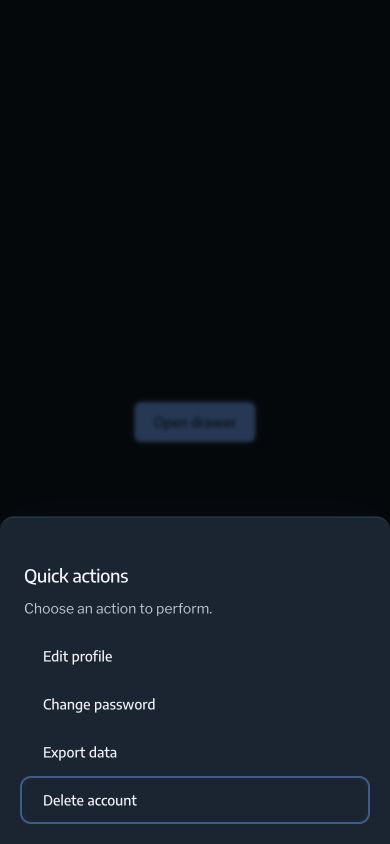
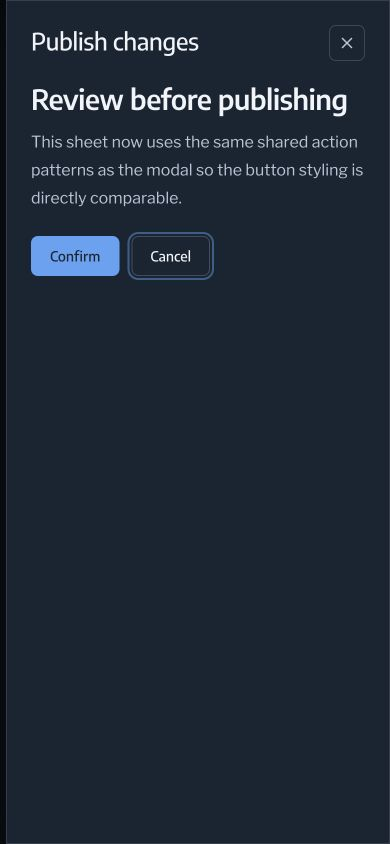
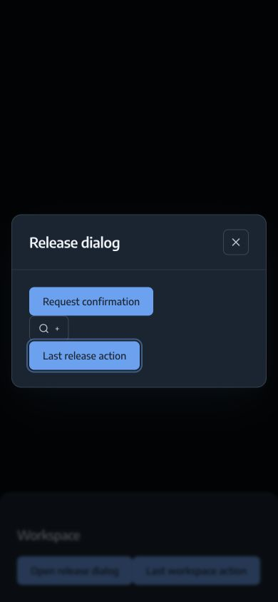
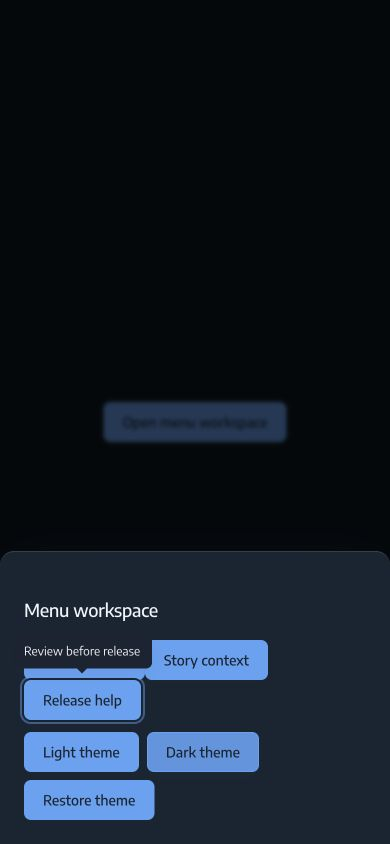

# Modal keyboard lifecycle

Drawer, Sheet, Modal, AlertDialog, and CommandSpotlight share `useModalLayer`.
When an open panel attaches to the DOM,
focus moves to its first visible, enabled Tab stop, or to the panel itself when
there are no controls. Opening from a closed state must work even when entrance
presence mounts the portal in a later React commit.

Tab and Shift-Tab wrap within the active panel. The control list is recalculated
for each key event, including dynamically added or removed controls. Hidden,
inert, disabled, disabled-fieldset, and negative-tab-index controls are excluded.
Logical React ancestry is retained across portals, so an initially-open child
retains priority even when its effect registers before its parent's effect.
Escape dismisses the topmost Bleecker modal. A nested selection popup can consume
Escape first; the panel remains open. Closing a child restores focus within its
parent. Closing the final modal restores the connected opening control.

The active panel and its owned portaled widgets remain interactive; underlying
panels and the document background are inert. Overlay depth follows the shared
stack, so visual and keyboard priority agree. Body children added while a modal
is active receive the same inert treatment; prior inert values are restored on
cleanup. The document has one shared body scroll lock. Closing or unmounting a parent
while a child is open does not unlock the background. Removing the final panel
restores the prior inline overflow value. Listeners and stack entries are removed
on closure or unmount. A closing panel is inert and hidden from accessibility
navigation during its retained exit animation; the backdrop no longer intercepts
pointer input.

The public modal component props and object-ref hook signature are unchanged.
Typography, theme tokens, motion, SSR guards, and reduced-motion rules remain the
established Bleecker contract. Modal and AlertDialog now use managed portals
instead of independent native-dialog event lifecycles; this gives mixed overlays
one focus and dismissal owner. AlertDialog explicitly uses the `alertdialog`
role. The hook observes DOM attachment after each
commit so callers can retain the object ref; unchanged attachments do not restart
the modal effect. Custom hook consumers must attach that ref to a focusable panel
(normally `tabIndex={-1}`), and provide a meaningful accessible dialog name.
Wrap nested content in `ModalLayerScope` with that ref to preserve ancestry.
Use `useModalBranch` for custom portaled widgets belonging to the panel.
Bleecker's Popover, Select, DropdownMenu contents/subcontents, and ContextMenu
contents and Tooltip register their owned portals automatically, preserving forwarded refs.

Native Tab stops, editable hosts (including empty and `plaintext-only`
contenteditable values), radio groups, and positive tab indexes participate in
the sequential focus list. Tab moves through that list, so document-level
positive-tab-index ordering cannot introduce background stops. Widgets that
handle a key themselves retain their own keyboard behavior.

## Regression fixtures

Storybook includes these interaction fixtures:

- Drawer and Sheet / **Keyboard Lifecycle**: closed-to-open focus, forward and
  reverse Tab, disabled/hidden controls, selection-popup Escape, dynamic actions,
  nested Sheet dismissal, callback changes, reopening during exit, and unmount.
- Drawer and Sheet / **Initially Open**: activation without a trigger click.
- Drawer and Sheet / **Parent Unmount**: a nested Sheet survives parent removal
  and retains the scroll lock, then restores the original page trigger.
- Drawer / **Empty And Dynamic**: panel focus followed by a newly arriving action.
- Drawer / **Mixed Modal Stack**, also exposed under Modal, AlertDialog, and
  CommandSpotlight: Drawer → Modal → AlertDialog or CommandSpotlight, independent
  Escape dismissal, inert parent panels, and focus return through the stack.
- Drawer / **Simultaneous Nested**: child and parent mount open together; visual
  depth and keyboard ownership agree.
- Drawer / **Modal Portal Ownership**, also exposed under DropdownMenu,
  ContextMenu, and Tooltip: nested-menu arrow navigation, popup Escape without
  closing the workspace, accessible tooltip content inside the active modal, and computed text contrast
  of at least 4.5:1 in light and dark themes.
- Drawer / **Nested Portal Focus Return**: a dialog launched from an owned widget
  restores focus to that widget, then the workspace restores the page opener.
- Drawer / **Native Focus Order**, **Portaled Widget**, and **Frame Realm**:
  summary and editable hosts, positive tab indexes, a two-control portaled popup,
  and focus return from an iframe-owned panel.

The normal Chromium suite runs all stories. A second browser instance runs the
Drawer and Sheet stories at 390 × 844 with `prefers-reduced-motion: reduce`; the
keyboard fixture checks the actual media query, viewport, and computed transition
duration. Use `npm run check`, `npm run build`, and `npm run build-storybook`.

## Evidence and delivery boundary

The original implementation fails both closed-to-open keyboard regressions:
focus remains on **Open panel** behind the modal. The repaired browser fixtures
exercise the real components, presence hook, body portal, and keyboard events.
Replaying the five composition fixtures against the first PR implementation
(`db09967`) fails all ten normal/reduced-motion runs. The revised implementation
passes the same cases. The screenshots below are committed repository assets;
the automated review's missing-image report was checked against the Git tree and
GitHub content API.

Manual Chrome verification at 390 × 844 checks Drawer / Default and Sheet / Right:
focus enters the panel, Shift-Tab reaches its final action, Tab wraps to its first
action, Escape closes the panel, focus returns to the trigger, and overflow is
restored. The screenshots show the visible keyboard focus ring:

Manual Chrome verification of **Mixed Modal Stack** at 390 × 844 additionally
checks Drawer → Modal → AlertDialog and CommandSpotlight. Each Escape closes only
the active layer and restores its trigger in the remaining layer. After the final
exit animation, the page trigger is focused, body overflow is restored, and no
body child remains inert. The screenshot shows reverse-Tab focus on the modal's
last action above its inert Drawer parent:

Manual Chrome at the same mobile width confirms keyboard focus on **Release
help** exposes **Review before release** with no inert ancestor. Escape closes
the tooltip alone, then a second Escape closes the Drawer and restores the page
opener and scrolling.

Revised validation on 2026-10-10: `npm run check` passed all 366 tests across 110
story files/instances. Package and static Storybook builds passed. The build now
imports the packaged root and renders all five modal surfaces
through `renderToString` without a DOM, in both open and closed states.
The package root previously exported missing `core.js` and `tokens.js` paths;
explicit directory-index exports at the root and theme-script boundary correct
that existing packaging defect.
`npm run check:runtime` runs after compilation and during `prepack`, so a build
cannot pass with an unloadable root entry point.
The tooltip ownership regression fails in both browser instances when its
portal registration is removed. Its dark-theme contrast regression also fails
with the original dark text token; the corrected foreground uses the existing
`text-primary` token. These targeted checks do not establish full accessibility
conformance for the component library. Menu assertions follow the pinned Radix
behavior: Arrow Left returns from a submenu; Escape closes the menu tree.
Menubar and HoverCard remain inside their owning panel rather than portaling.
Global alert, notification, and loading surfaces mounted outside that panel
remain part of the inert background; they do not gain modal ownership implicitly.
Select and HeaderSelect fixtures await the rendered listbox rather than assuming
that a click has already committed its portal. Widgets outside a modal do not
register branches or receive attachment-driven state updates.
The full suite ran without a concurrent Storybook development server; sharing
its generated Vite cache with Vitest had caused module-loading failures.

This evidence covers local Bleecker behavior. Package publication, Ariston's
dependency update, its Compose-served application workflow, CI, and production
deployment are separate release steps. A package build does not establish that a
consumer has received the fix. No backend or telemetry behavior changes here.
Version 0.1.42 is prepared for
the normal tagged package release; publication is not established by this document.

The keyboard and inert-background contract follows the
[WAI-ARIA modal dialog pattern](https://www.w3.org/WAI/ARIA/apg/patterns/dialog-modal/).
The text contrast check uses the
[WCAG contrast minimum](https://www.w3.org/WAI/WCAG22/Understanding/contrast-minimum.html).

Initial validation on 2026-10-10: `npm run check` passed 346 tests across 110 story
files/instances, including the 12 repeated modal stories under reduced motion.
The package and Storybook builds passed. After replacing the empty-panel fixture's
timer with an explicit Arrow Down action, all 24 modal story runs passed again.
The explicit action keeps the empty-state assertion independent of CPU timing.

The public repository wiki remote was unavailable during the mandatory freshness
check; documentation is maintained here until that wiki becomes accessible.
